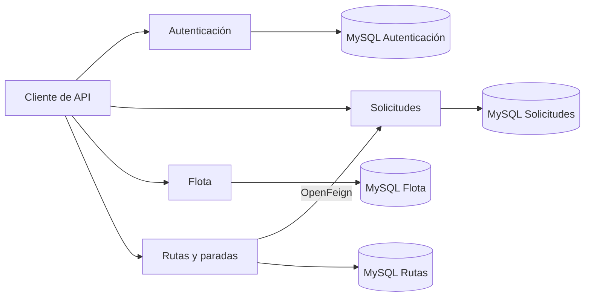

# ♻️ RutaLimpia

Backend de un proyecto desarrollado en equipo para gestionar solicitudes de retiro de residuos a domicilio, desde la solicitud del vecino hasta la asignación de una ruta y el registro del resultado del retiro.

**Java 21 · Spring Boot · Spring Security · JWT · MySQL · Docker Compose · OpenFeign**

## 🤝 Equipo y créditos

- **[Francisco Vallverdú](https://github.com/frvallverdu)** — integrante y coautor; desarrollo los microservicios **autenticacionMS** y **solicitudesMS**
- **[Diego Ramos](https://github.com/Diego-Git09)** — integrante y coautor; desarrolló los microservicios **rutasMS** y **flotaMS**.

Repositorio de origen: [frvallverdu/RutaLimpia](https://github.com/frvallverdu/RutaLimpia).

Esta copia presenta el proyecto como parte de mi portafolio y conserva los créditos del trabajo compartido. El repositorio de origen puede requerir permisos de acceso.

## 👨‍💻 Mi participación

Mi aporte al proyecto original se concentró en rutas y flota.

### Gestión de rutas

- Creación, consulta, actualización y eliminación de rutas.
- Consulta de rutas por camión y conductor.
- Control de asignaciones duplicadas por fecha.
- Registro y consulta de paradas.
- Registro de retiros exitosos y fallidos.
- Comunicación con el microservicio de solicitudes mediante OpenFeign.
- Restricción de eliminación de rutas que tienen paradas.

### Gestión de flota

- Registro, consulta y actualización de camiones.
- Consulta de camiones disponibles.
- Cambios de estado: `DISPONIBLE`, `EN_RUTA` y `EN_MANTENCION`.
- Validaciones de patente, capacidad y estado.
- Rechazo de patentes duplicadas.
- Restricción de eliminación de camiones que están en ruta.

### Mejoras posteriores en esta copia

- Comprobación de que cada vecino solo pueda crear y consultar sus propias solicitudes.
- Conservación de los códigos HTTP correspondientes a errores de datos, permisos y recursos inexistentes.
- Ampliación del flujo de pruebas con datos ficticios.

## 🧩 Microservicios

| Microservicio | Responsabilidad | Puerto |
|---|---|---|
| `autenticacionMS` | Registro de vecinos, inicio de sesión y credenciales JWT | 8086 |
| `solicitudesMS` | Solicitudes de retiro, categorías de residuos y estados | 8084 |
| `flotaMS` | Camiones, disponibilidad y estados de la flota | 8085 |
| `rutasMS` | Rutas, paradas y resultados de los retiros | 8087 |

Cada microservicio utiliza una base de datos MySQL independiente.

Este repositorio contiene el backend y sus APIs REST. Próximamente incluiremos una Interfaz Web.

## 🔄 Flujo de un retiro

1. Un vecino se registra e inicia sesión.
2. Crea una solicitud indicando dirección, tipo de residuo, cantidad y horario preferido.
3. Se registra una ruta con un camión y un conductor.
4. La solicitud se incorpora como parada de la ruta.
5. Rutas comunica la asignación a Solicitudes.
6. Se registra el resultado del retiro y se actualiza la solicitud.

| Acción | Estado de la solicitud |
|---|---|
| Crear solicitud | `PENDIENTE` |
| Asignar una parada | `ASIGNADA` |
| Registrar retiro exitoso | `REALIZADA` |
| Registrar retiro fallido con motivo | `FALLIDA` |

## 🏗️ Arquitectura



## 🚀 Ejecución local

### Requisitos

- Docker con Docker Compose.
- Python 3 para preparar la configuración y ejecutar la demostración.
- Conexión a internet para descargar imágenes y dependencias durante la primera construcción.

Para compilar fuera de Docker se necesita Java 21 y Maven, o el wrapper incluido en cada microservicio.

### 1. Clonar el repositorio

```bash
git clone https://github.com/Diego-Git09/RutaLimpia.git
cd RutaLimpia
```

### 2. Preparar la configuración

```bash
python3 herramientas/preparar_entorno.py
```

El script crea un archivo `.env` con claves aleatorias para el entorno local. No muestra sus valores ni sobrescribe un archivo existente.

`.env` está excluido de Git. `.env.example` contiene únicamente los nombres de las variables y valores de ejemplo que deben reemplazarse.

### 3. Construir e iniciar los servicios

```bash
docker compose up -d --build
```

La primera construcción puede tardar mientras se descargan las dependencias.

La configuración utiliza el nombre `rutalimpia-portafolio` para sus contenedores y volúmenes. Los puertos configurados deben estar disponibles.

### 4. Consultar el estado

```bash
docker compose ps
```

### 5. Ejecutar la demostración

```bash
python3 herramientas/probar_flujo.py
```

### 6. Detener los servicios

```bash
docker compose down
```

Este comando conserva los datos almacenados en los volúmenes.

## 🧪 Pruebas del flujo

Se comprobaron, entre otros casos:

- Registro e inicio de sesión de vecinos.
- Rechazo de correos duplicados.
- Acceso únicamente a las solicitudes propias.
- Rechazo de credenciales inválidas o alteradas.
- Rechazo de cantidades negativas y categorías inexistentes.
- Validaciones de camiones y asignaciones de rutas.
- Comunicación entre Rutas y Solicitudes.
- Registro de retiros exitosos y fallidos.
- Rechazo de resultados duplicados.
- Restricciones de eliminación de rutas y camiones.

Cada ejecución crea nuevos datos ficticios y los conserva para poder revisarlos.

Como todavía no existe una API para registrar conductores, la demostración cambia mediante SQL el rol de un usuario ficticio creado por el propio script. Después obtiene su credencial mediante el inicio de sesión normal. Este paso requiere acceso a Docker.

Las comprobaciones cubren el recorrido de demostración; no equivalen a cobertura completa de todas las reglas de negocio.

## 📂 Organización

```text
RutaLimpia/
├── autenticacionMS/
├── solicitudesMS/
├── flotaMS/
├── rutasMS/
├── herramientas/
│   ├── preparar_entorno.py
│   └── probar_flujo.py
├── documentacion/
├── docker-compose.yml
├── .env.example
└── README.md
```

## 📌 Alcance actual

El proyecto está preparado para una demostración local de sus APIs.

La copia de portafolio excluye las claves y el historial Git del repositorio original. Los ejemplos y las pruebas utilizan datos ficticios.
