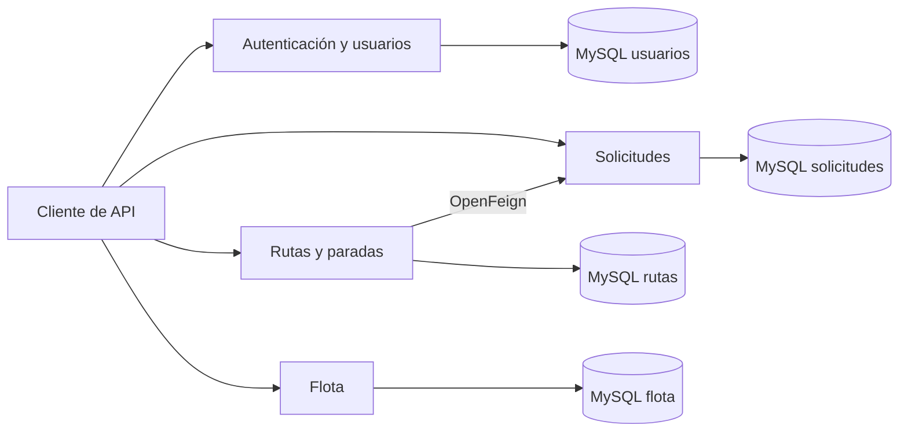
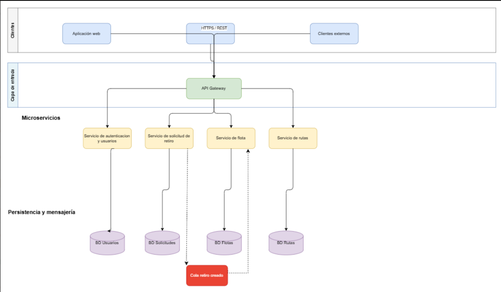

# RutaLimpia

Proyecto en equipo para gestionar solicitudes de retiro de residuos a domicilio, incluidos residuos tóxicos y otros tipos. El backend organiza las solicitudes, los usuarios, las rutas de retiro y la flota de camiones.

**Java 21 · Spring Boot · MySQL · Docker Compose · APIs REST**

## Equipo y participación

- **[Francisco Vallverdú](https://github.com/frvallverdu)** — integrante y coautor del proyecto.
- **[Diego Ramos](https://github.com/Diego-Git09)** — integrante y coautor; desarrolló los microservicios **rutasMS** y **flotaMS**.

Repositorio de origen: [frvallverdu/RutaLimpia](https://github.com/frvallverdu/RutaLimpia). El enlace se obtuvo del remoto Git de la copia original; su disponibilidad pública no se pudo confirmar durante esta preparación.

Esta presentación conserva el reconocimiento de ambos integrantes. No se atribuye el proyecto completo a una sola persona.

## Mi aporte: rutas y flota

### Rutas

- Registro, consulta, actualización y eliminación de rutas.
- Consulta de rutas por camión y conductor.
- Gestión de paradas y registro de sus resultados.
- Comunicación con solicitudes mediante OpenFeign para informar asignaciones y resultados.

### Flota

- Registro, consulta y actualización de camiones.
- Consulta de camiones disponibles y cambios de estado.
- Validaciones de patente, capacidad y estados permitidos.
- Restricciones como impedir eliminar un camión que está en ruta.

Se comprobó el arranque de los cuatro servicios con MySQL y un flujo de retiro con datos ficticios. Consulta las [comprobaciones y límites](documentacion/COMPROBACIONES.md).

## Servicios incluidos

| Servicio | Responsabilidad | Puerto local del contenedor |
|---|---|---|
| autenticacionMS | Usuarios, autenticación y generación de tokens JWT | 8086 |
| solicitudesMS | Solicitudes y tipos de residuos | 8084 |
| flotaMS | Camiones, disponibilidad y estados | 8085 |
| rutasMS | Rutas, paradas y comunicación con solicitudes | 8087 |

Cada servicio utiliza una base MySQL independiente en la configuración de Docker Compose. El repositorio revisado contiene el backend; no incluye una aplicación web de cliente.

## Arquitectura presente en el código



### Diseño propuesto por el equipo



El diagrama original propone además una aplicación web, un API Gateway y una cola de mensajes. Esos componentes no están implementados en los archivos de esta copia y no se presentan como funcionalidades terminadas.

## Preparación local

Necesitas Docker con Docker Compose. Para generar la configuración local con el script incluido también necesitas Python 3. Para compilar fuera de Docker necesitas Java 21 y Maven, o el wrapper de cada servicio.

1. Abre una terminal en la carpeta del proyecto.
2. Genera un archivo `.env` con valores nuevos para tu equipo:

```bash
python3 herramientas/preparar_entorno.py
```

El script no muestra los valores generados y no sobrescribe un `.env` existente. `.env.example` documenta los nombres necesarios, pero sus marcadores no son claves utilizables.

3. Construye e inicia los servicios:

```bash
docker compose up --build
```

El arranque con construcción de imágenes se comprobó el 27/10/2026. La configuración está orientada a desarrollo local.

La configuración usa el nombre `rutalimpia-portafolio` para separar sus contenedores y volúmenes de los de la copia original. Los puertos deben estar libres antes de arrancar.

4. Para detener los contenedores conservando los datos:

```bash
docker compose down
```

## Algunas rutas de API

| Método | Ruta | Servicio |
|---|---|---|
| POST | `/api/auth/login` | Autenticación |
| POST | `/api/usuarios/vecinos` | Usuarios |
| GET, POST | `/api/camiones` | Flota |
| GET | `/api/camiones/disponibles` | Flota |
| PATCH | `/api/camiones/{id}/estado` | Flota |
| GET, POST | `/api/rutas` | Rutas |
| GET | `/api/rutas/camion/{idCamion}` | Rutas |
| GET | `/api/rutas/conductor/{idConductor}` | Rutas |
| GET, POST | `/api/rutas/{idRuta}/paradas` | Paradas |
| PATCH | `/api/rutas/{idRuta}/paradas/{idParada}/resultado` | Paradas |

La demostración incluida utiliza estas APIs con datos ficticios. Autenticación y Solicitudes utilizan JWT y roles; Flota y Rutas aún no tienen control de acceso propio. Consulta los límites antes de exponer los servicios fuera de un entorno local.

## Compilación y pruebas

Para compilar un servicio, por ejemplo flota:

```bash
cd flotaMS
./mvnw -DskipTests package
```

Comprobación del 27/10/2026: **los cuatro servicios compilaron y generaron sus JAR** con Java 21 y Maven, utilizando dependencias ya disponibles en el equipo. No se ejecutaron las pruebas al compilar.

También se ejecutaron las **4 pruebas `contextLoads`, sin errores**, conectadas a las bases MySQL de demostración. Estas pruebas comprueban el inicio del contexto de Spring; no equivalen a cobertura de todas las reglas de negocio.

Con los contenedores encendidos, ejecuta desde la carpeta raíz:

```bash
python3 herramientas/probar_flujo.py
```

Resultado comprobado el 27/10/2026: **13 comprobaciones aprobadas**. El recorrido crea un vecino, inicia sesión, registra una solicitud, un camión, una ruta y una parada, y comprueba el cambio `PENDIENTE → ASIGNADA → REALIZADA`. Incluye rechazos por duplicados, permisos y restricciones de eliminación.

Cada ejecución añade datos ficticios nuevos y los conserva. El script necesita acceso a Docker y promueve a CONDUCTOR únicamente al usuario ficticio que acaba de crear, mediante SQL en la base de demostración: todavía no existe un endpoint para crear conductores. Después obtiene su token por el inicio de sesión real. No imprime contraseñas ni tokens.

Los servicios no verifican todavía que el ID de camión o conductor asignado a una ruta exista en los demás servicios. El script utiliza el camión creado durante la prueba, pero eso no demuestra que exista esa validación.

## Configuración y datos

La copia de portafolio excluye `.env`, archivos de editor, resultados de compilación y el historial Git original. Conserva los cambios de código locales del proyecto de origen. No se modificó la carpeta original.

Los SQL incluidos cargan roles y categorías de residuos; no contienen una cartera de clientes o solicitudes reales. No publiques valores de claves JWT, contraseñas ni datos personales al añadir ejemplos.

## Estado y próximos pasos

- Incorporar control de acceso en Flota y Rutas, y comprobar que cada vecino solo pueda acceder a sus propias solicitudes.
- Corregir la respuesta HTTP de rol insuficiente en Solicitudes: actualmente devuelve 401 en el caso probado; debería distinguirse de la falta de autenticación.
- Crear un mecanismo de alta de conductores y validar las referencias entre servicios.
- Añadir pruebas de las reglas de negocio de rutas y flota.
- Confirmar la disponibilidad del enlace de Francisco y del repositorio de origen.
- Acordar la licencia con ambos integrantes antes de añadir una licencia para todo el proyecto.
