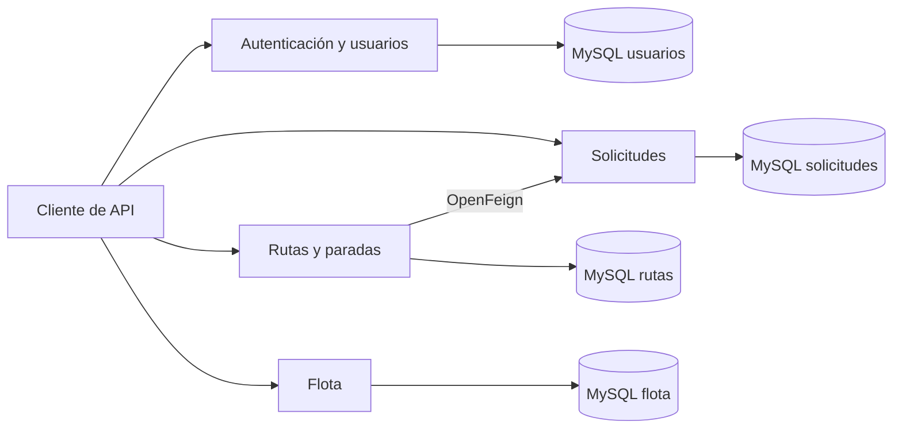

# RutaLimpia

Proyecto en equipo para gestionar solicitudes de retiro de residuos a domicilio, incluidos residuos tóxicos y otros tipos. El backend organiza las solicitudes, los usuarios, las rutas de retiro y la flota de camiones.

**Java 21 · Spring Boot · MySQL · Docker Compose · APIs REST**

## Equipo y participación

- **[Francisco Vallverdú](https://github.com/frvallverdu)** — integrante y coautor del proyecto; desarrolló los microservicios **autenticacion** y **solicitudes**
- **[Diego Ramos](https://github.com/Diego-Git09)** — integrante y coautor; desarrolló los microservicios **rutasMS** y **flotaMS**.

Esta presentación conserva el reconocimiento de ambos integrantes. No se atribuye el proyecto completo a una sola persona.

## Mi aporte: rutas y flota

### Rutas

- Registro, consulta, actualización y eliminación de rutas.
- Consulta de rutas por camión y conductor.
- Gestión de paradas y registro de sus resultados.
- Comunicación con solicitudes mediante OpenFeign para informar asignaciones y resultados.

### Flota

- Registro, consulta y actualización de camiones.
- Consulta de camiones disponibles y cambios de estado.
- Validaciones de patente, capacidad y estados permitidos.
- Restricciones como impedir eliminar un camión que está en ruta.

Se comprobó el arranque de los cuatro servicios con MySQL y un flujo de retiro con datos ficticios.

## Servicios incluidos

| Servicio | Responsabilidad | Puerto local del contenedor |
|---|---|---|
| autenticacionMS | Usuarios, autenticación y generación de tokens JWT | 8086 |
| solicitudesMS | Solicitudes y tipos de residuos | 8084 |
| flotaMS | Camiones, disponibilidad y estados | 8085 |
| rutasMS | Rutas, paradas y comunicación con solicitudes | 8087 |

Cada servicio utiliza una base MySQL independiente en la configuración de Docker Compose. El repositorio revisado contiene el backend; no incluye una aplicación web de cliente.

## Arquitectura presente en el código



## Preparación local

Necesitas Docker con Docker Compose. Para generar la configuración local con el script incluido también necesitas Python 3. Para compilar fuera de Docker necesitas Java 21 y Maven, o el wrapper de cada servicio.

1. Abre una terminal en la carpeta del proyecto.
2. Genera un archivo `.env` con valores nuevos para tu equipo:

```bash
python3 herramientas/preparar_entorno.py
```

El script no muestra los valores generados y no sobrescribe un `.env` existente. `.env.example` documenta los nombres necesarios, pero sus marcadores no son claves utilizables.

3. Construye e inicia los servicios:

```bash
docker compose up --build
```

La configuración está orientada a desarrollo local.

Los puertos deben estar libres antes de arrancar.

4. Para detener los contenedores conservando los datos:

```bash
docker compose down
```

## Algunas rutas de API

| Método | Ruta | Servicio |
|---|---|---|
| POST | `/api/auth/login` | Autenticación |
| POST | `/api/usuarios/vecinos` | Usuarios |
| GET, POST | `/api/camiones` | Flota |
| GET | `/api/camiones/disponibles` | Flota |
| PATCH | `/api/camiones/{id}/estado` | Flota |
| GET, POST | `/api/rutas` | Rutas |
| GET | `/api/rutas/camion/{idCamion}` | Rutas |
| GET | `/api/rutas/conductor/{idConductor}` | Rutas |
| GET, POST | `/api/rutas/{idRuta}/paradas` | Paradas |
| PATCH | `/api/rutas/{idRuta}/paradas/{idParada}/resultado` | Paradas |

Consulta los límites antes de exponer los servicios fuera de un entorno local.

## Compilación y pruebas

Para compilar un servicio, por ejemplo flota:

```bash
cd flotaMS
./mvnw -DskipTests package
```

Con los contenedores encendidos, ejecuta desde la carpeta raíz:

```bash
python3 herramientas/probar_flujo.py
```

## Configuración y datos


Los SQL incluidos cargan roles y categorías de residuos; no contienen una cartera de clientes o solicitudes reales. No publiques valores de claves JWT, contraseñas ni datos personales al añadir ejemplos.
